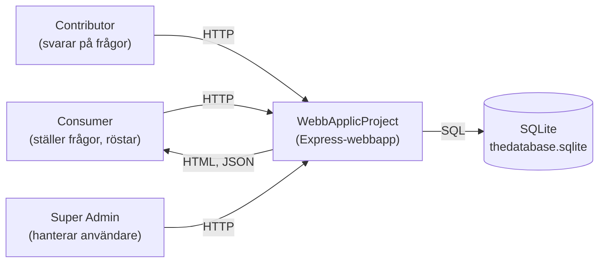
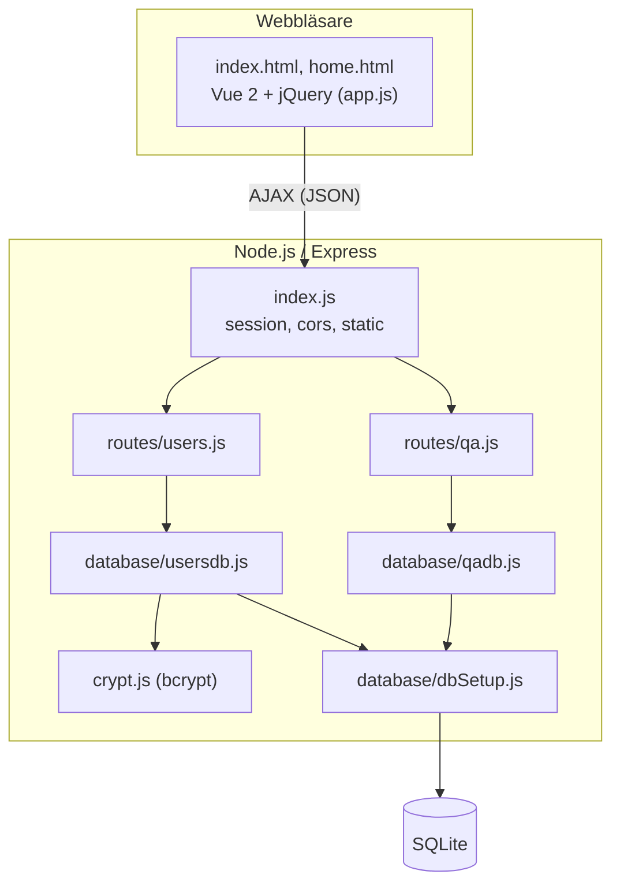
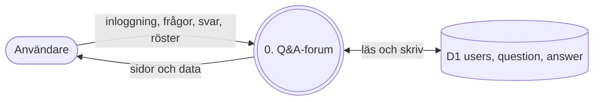
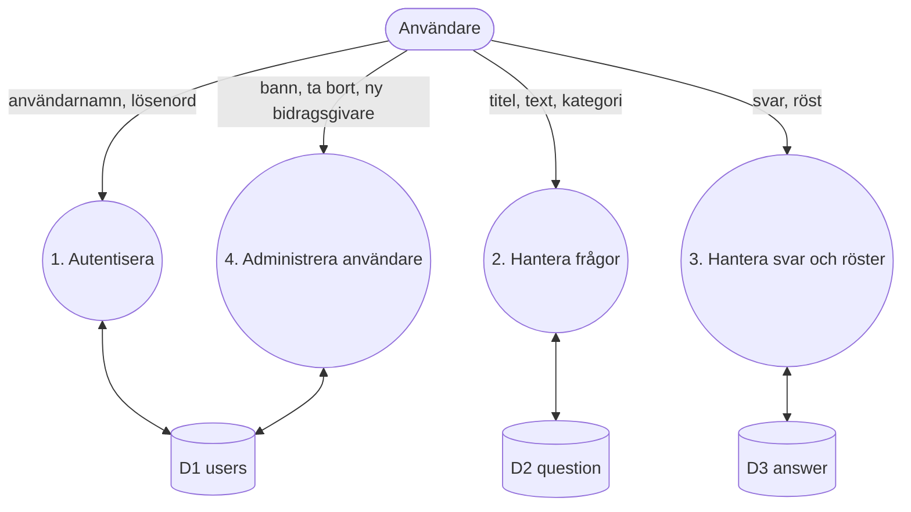
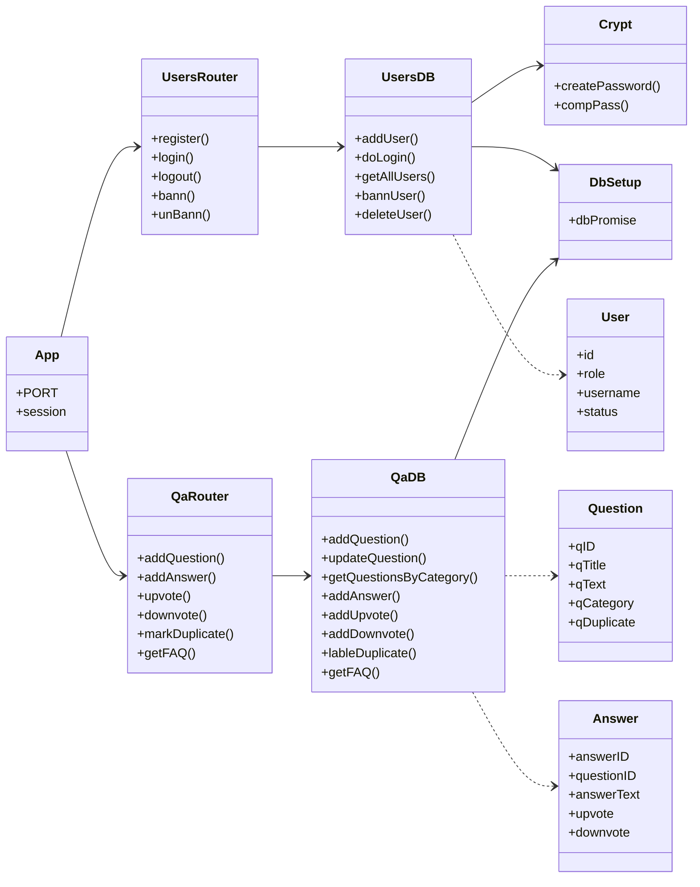
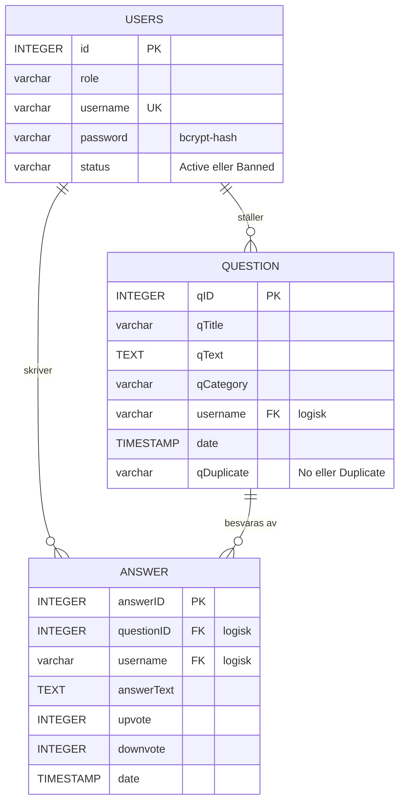
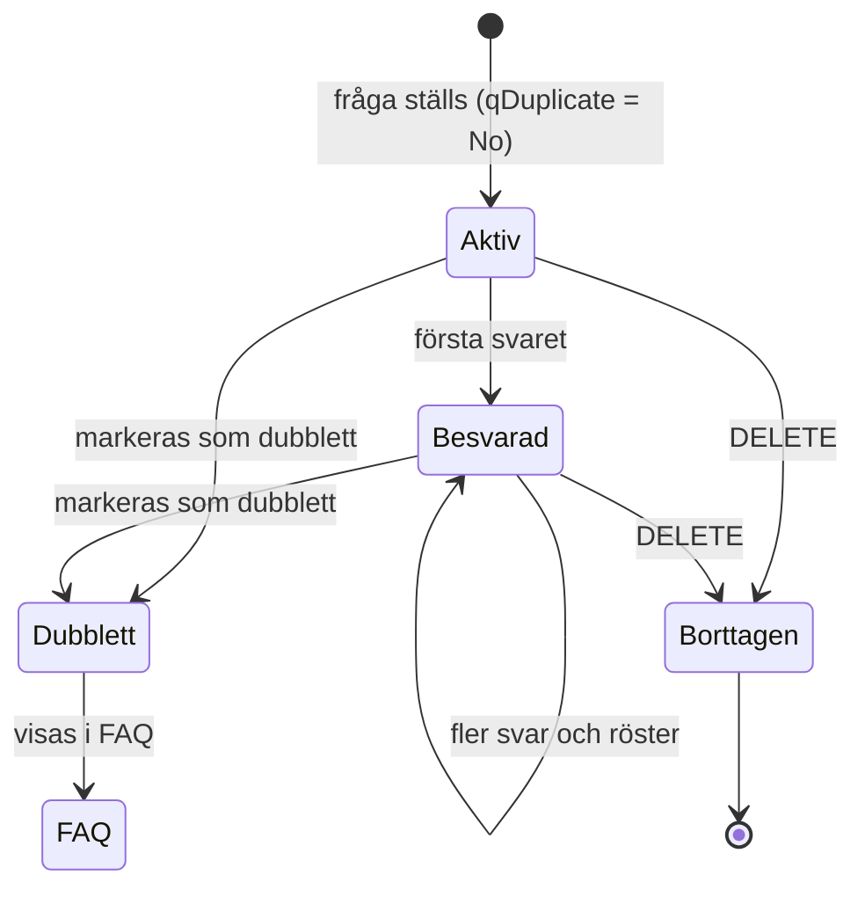
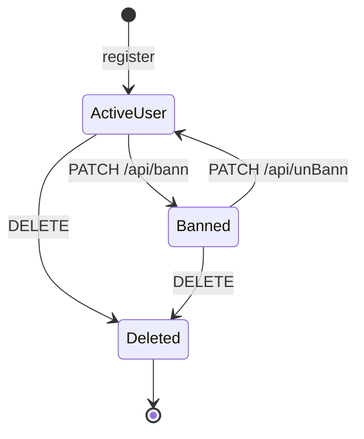
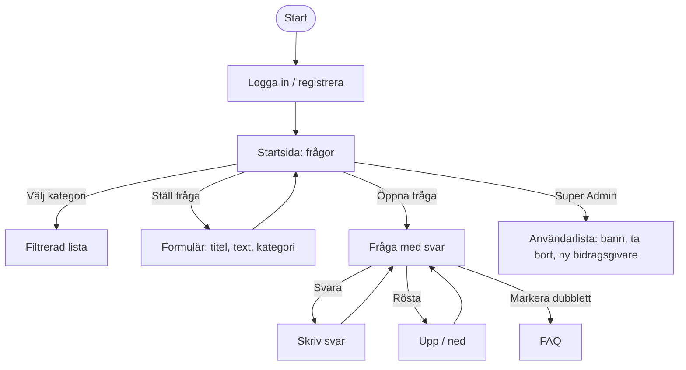
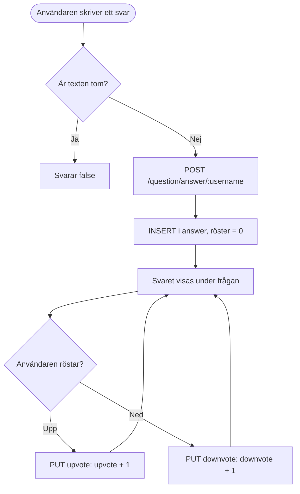

# WebbApplicProject

Ett frågor-och-svar-forum (Q&A) byggt som projektarbete i kursen Dynamiska webbapplikationer. Användare kan registrera sig, logga in, ställa frågor i olika kategorier, svara, rösta på svar och markera frågor som dubbletter. Dubblettfrågor samlas i en FAQ. En Super Admin kan hantera användare, till exempel lägga till bidragsgivare och banna användare.

Själva applikationen ligger i mappen [`DynamiskaWebbapplikationerProjektArbete2021`](DynamiskaWebbapplikationerProjektArbete2021). Projektet är en vidareutveckling av [DynamiskaApplProject](https://github.com/Thedoniki/DynamiskaApplProject).

## Innehåll

- [Teknikstack](#teknikstack)
- [Kom igång](#kom-igång)
- [Projektstruktur](#projektstruktur)
- [API](#api)
- [Datamodell](#datamodell)
- [Systemkontextdiagram](#systemkontextdiagram)
- [Arkitekturdiagram](#arkitekturdiagram-c4)
- [Dataflödesdiagram](#dataflödesdiagram-dfd)
- [UML-klassdiagram](#uml-klassdiagram)
- [ER-diagram](#er-diagram)
- [Tillståndsdiagram](#tillståndsdiagram)
- [User flows](#user-flows)
- [Flödesschema: svara och rösta](#flödesschema-svara-och-rösta)
- [User stories](#user-stories)
- [Wireframes](#wireframes)
- [Klickbar prototyp](#klickbar-prototyp)
- [Agila metoder](#agila-metoder)
- [CI/CD](#cicd)
- [Kända problem](#kända-problem)

## Teknikstack

| Del | Teknik |
| --- | --- |
| Server | Node.js, Express 4 |
| Databas | SQLite (`sqlite`, `sqlite3`) |
| Lösenord | bcrypt |
| Sessioner | express-session |
| Frontend | HTML, CSS, jQuery och Vue 2 |

## Kom igång

Krav: Node.js 18 eller senare.

```bash
cd DynamiskaWebbapplikationerProjektArbete2021
npm install
npm start          # startar på http://localhost:3055
```

Porten kan ändras med miljövariabeln `PORT`.

Databasen ligger i `thedatabase.sqlite` och tabellerna definieras i `sql.sql`. Exempelanrop finns i `request.rest`.

## Projektstruktur

```
.
├── README.md
├── .github/workflows/          # CI och kodanalys
├── docs/prototype.html         # Klickbar prototyp
└── DynamiskaWebbapplikationerProjektArbete2021/
    ├── index.js                # Startar Express och kopplar ihop routes
    ├── crypt.js                # bcrypt: hashning och jämförelse
    ├── routes/
    │   ├── users.js            # Registrering, inloggning, användarhantering
    │   └── qa.js               # Frågor, svar, röster och FAQ
    ├── database/
    │   ├── dbSetup.js          # Öppnar SQLite-anslutningen
    │   ├── usersdb.js          # Databasfunktioner för användare
    │   └── qadb.js             # Databasfunktioner för frågor och svar
    ├── public/                 # index.html, home.html, app.js, styles.css
    ├── sql.sql                 # Skapar tabellerna
    └── request.rest            # Exempelanrop
```

## API

Användarrouten är monterad på `/api/` och frågerouten på `/`.

### Användare (`/api`)

| Metod | Sökväg | Beskrivning |
| --- | --- | --- |
| POST | `/api/register/` | Registrerar en användare. |
| POST | `/api/addcontributor/` | Lägger till en bidragsgivare. |
| POST | `/api/login/` | Loggar in. Bannade användare nekas. |
| GET | `/api/loggedinuser` | Hämtar den inloggade användaren från sessionen. |
| GET | `/api/logout/` | Avslutar sessionen. |
| GET | `/api/users/` | Hämtar alla användare. |
| GET | `/api/contributors/` | Hämtar alla bidragsgivare. |
| GET | `/api/user/:username`, `/api/thisUser/:username` | Hämtar en användare. |
| PUT | `/api/user/:id` | Uppdaterar roll, användarnamn och status. |
| PATCH | `/api/bann/:username`, `/api/unBann/:username` | Bannar eller avbannar en användare. |
| DELETE | `/api/user/delete/:id` | Tar bort en användare. |

### Frågor och svar

| Metod | Sökväg | Beskrivning |
| --- | --- | --- |
| POST | `/question/:username/` | Ställer en fråga (`qTitle`, `qText`, `qCategory`). |
| GET | `/questions/` | Hämtar alla frågor. |
| GET | `/question/:id` | Hämtar en fråga. |
| GET | `/questions/user/:username` | Hämtar en användares frågor. |
| GET | `/questions/filter/:category` | Filtrerar frågor på kategori. |
| GET | `/questions/allCategories` | Hämtar kategorier. |
| GET | `/questions/faq` | Hämtar frågor markerade som dubbletter (FAQ). |
| PATCH | `/question/:qID` | Uppdaterar en fråga. |
| PATCH | `/question/duplicate/:qID` | Markerar en fråga som dubblett. |
| DELETE | `/question/delete/:qID` | Tar bort en fråga. |
| POST | `/question/answer/:username` | Svarar på en fråga (`id`, `text`). |
| GET | `/question/answer/:id` | Hämtar svar på en fråga. |
| GET | `/answers/`, `/answer/:id` | Hämtar alla svar eller ett svar. |
| PATCH | `/updateAnswer/:answerID` | Ändrar ett svar. |
| PUT | `/question/answer/upvote/:answerID` | Ger ett svar en röst upp. |
| PUT | `/question/answer/downvote/:answerID` | Ger ett svar en röst ned. |
| DELETE | `/answer/delete/:answerID` | Tar bort ett svar. |

## Datamodell

- **users**: roll (`Super Admin`, `Contributor`, `Consumer`), unikt användarnamn, bcrypt-hashat lösenord och status (`Active` eller `Banned`).
- **question**: titel, text, kategori, författare, datum och `qDuplicate` (`No` eller `Duplicate`).
- **answer**: svarstext, författare, antal röster upp och ned, datum och kopplingen till frågan.

Kopplingar sker via `username` och `questionID`. Det finns inga främmande nycklar i `sql.sql`.

## Systemkontextdiagram



## Arkitekturdiagram (C4)



## Dataflödesdiagram (DFD)

### Nivå 0



### Nivå 1



## UML-klassdiagram



## ER-diagram



Relationerna är logiska. Databasen har inga främmande nycklar.

## Tillståndsdiagram

Livscykeln för en fråga och för ett användarkonto.





## User flows



## Flödesschema: svara och rösta



## User stories

1. **Som besökare** vill jag registrera mig och logga in, så att jag kan delta i forumet.
2. **Som Consumer** vill jag ställa en fråga i en kategori, så att jag får svar av andra.
3. **Som Consumer** vill jag ändra eller ta bort min egen fråga, så att jag kan rätta misstag.
4. **Som Contributor** vill jag svara på frågor, så att jag kan hjälpa andra.
5. **Som användare** vill jag rösta upp eller ned ett svar, så att de bästa svaren syns.
6. **Som användare** vill jag filtrera frågor på kategori, så att jag hittar rätt ämne snabbt.
7. **Som användare** vill jag läsa en FAQ med vanliga frågor, så att jag slipper ställa en fråga som redan finns.
8. **Som Super Admin** vill jag banna en användare, så att regelbrytare inte kan logga in.
9. **Som Super Admin** vill jag lägga till bidragsgivare, så att rätt personer kan svara.

## Wireframes

```
Startsida
+----------------------------------------------------------+
| Forum              [Kategori v]     Inloggad: namn [Logga ut] |
+----------------------------------------------------------+
| [ + Ställ en fråga ]                                      |
| +------------------------------------------------------+ |
| | Titel                              Kategori   Datum   | |
| | Text (första raden...)             2 svar             | |
| +------------------------------------------------------+ |
| | Titel ...                                              | |
+----------------------------------------------------------+

Fråga med svar
+----------------------------------------------------------+
| Titel                        [Markera dubblett] [Redigera] |
| Text                                                      |
|----------------------------------------------------------|
| Svar av Contributor        [ ^ 3 ]  [ v 1 ]               |
| Svar av ...                [ ^ 0 ]  [ v 0 ]               |
| [ Skriv ett svar...                               ] [Skicka]|
+----------------------------------------------------------+

Super Admin
+----------------------------------------------------------+
| Användare                     [ + Ny bidragsgivare ]       |
| namn   roll          status    [Banna] [Ta bort]          |
+----------------------------------------------------------+
```

## Klickbar prototyp

[`docs/prototype.html`](docs/prototype.html) är en klickbar prototyp med exempeldata. Öppna filen i en webbläsare. Inget sparas permanent.

## Agila metoder

Projektet passar en enkel Kanban-tavla med kolumnerna **Backlog**, **Redo**, **Pågående** (max två kort per person), **Granskning** och **Klar**. Varje user story ovan blir ett kort.

Vill gruppen köra Scrum fungerar korta sprintar på en vecka, med sprintplanering, kort daglig avstämning, sprintgranskning där man visar prototypen eller körbar version, och ett retrospektiv.

## CI/CD

[`.github/workflows/ci.yml`](.github/workflows/ci.yml) kör på varje push till `main` och på pull requests. Den installerar beroenden med `npm ci` och kontrollerar syntaxen i alla JavaScript-filer. Det finns inga automatiska tester ännu. [`codeql-analysis.yml`](.github/workflows/codeql-analysis.yml) kör säkerhetsanalys. Continuous Delivery är inte uppsatt.

## Kända problem

Det här är observationer från genomgången. Inget av det är åtgärdat i koden.

- **Hårdkodad sessionshemlighet.** `index.js` använder `thisisasecret`. Den bör läsas från en miljövariabel.
- **`node_modules` ligger i git.** Mappen är incheckad (över 2 700 filer) och det finns ingen `.gitignore`.
- **Nedröst räknas ned.** `addDownvote` i `database/qadb.js` gör `downvote - 1`, så räknaren blir negativ. Den bör räkna upp.
- **Stavfel i `sql.sql`.** `varcahr` och `varchar varchar(10)`. SQLite accepterar det, men det bör rättas.
- **Inloggningen kan svara flera gånger.** `routes/users.js` loopar över nycklarna i statusobjektet och kan skicka mer än ett svar.
- **Ingen behörighetskontroll.** Rutterna kontrollerar inte inloggning eller roll. Vem som helst kan till exempel ta bort frågor eller användare via API:et.
- **Appen ligger i en undermapp.** `package.json` hamnar inte bredvid README i rotmappen.
- **Fel hanteras ofta utan rätt statuskod,** eller utan svar alls, vilket lämnar anropet hängande.
- **Inga automatiska tester.**
